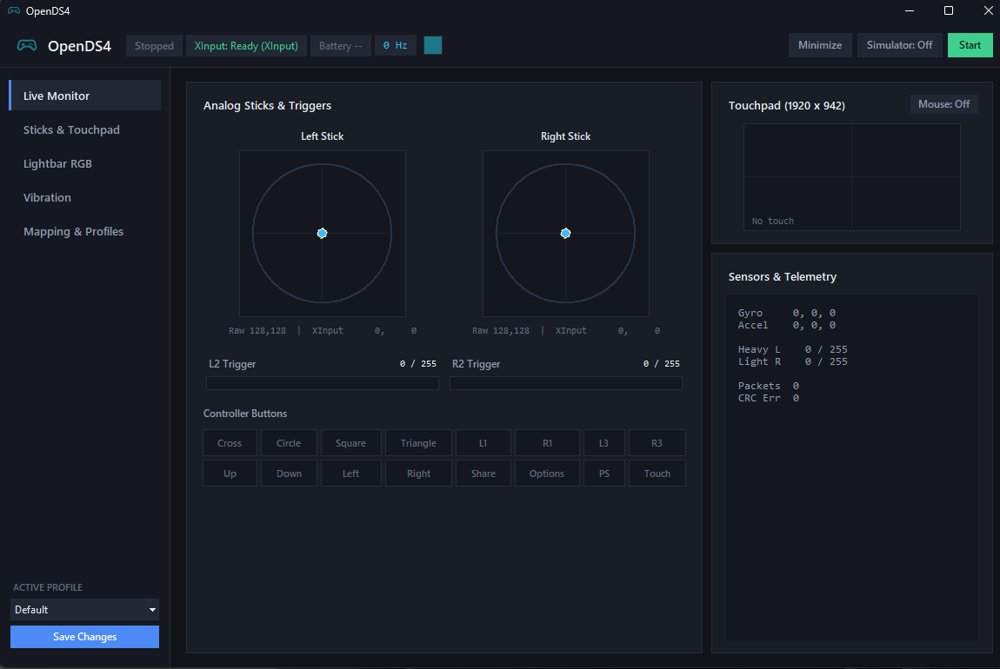
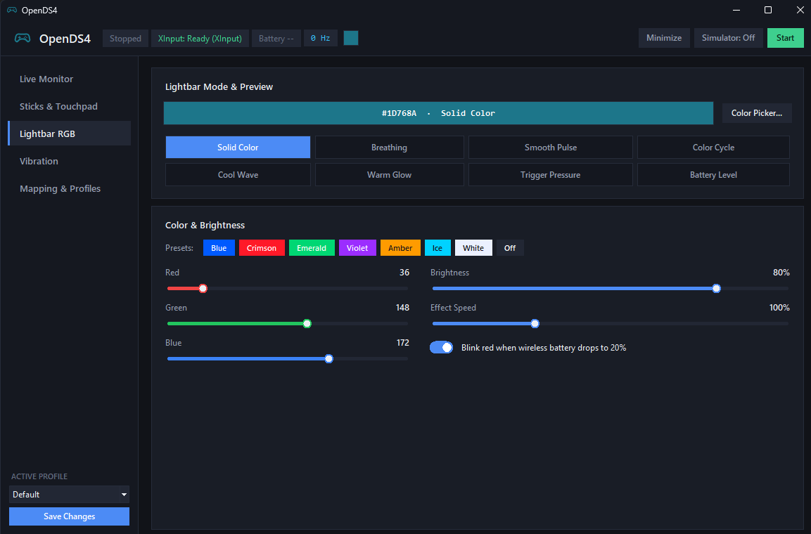
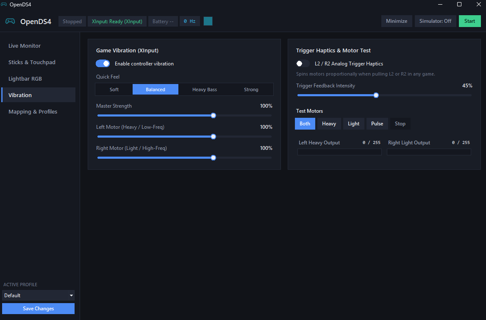

<div align="center">


# OpenDS4

A small Windows utility that lets you use a DualShock 4 controller as an Xbox 360 controller.

[](https://github.com/waterzyy/OpenDS4/actions/workflows/ci.yml)
[](LICENSE)

[Quick start](#quick-start) · [Screenshots](#screenshots) · [Features](#features) · [Docs](docs/) · [Contributing](CONTRIBUTING.md)

</div>

---

Hi! OpenDS4 is a little tool I made for using a DualShock 4 with games that only expect an Xbox controller.

It talks to the controller over USB or Bluetooth, translates the inputs, and presents a virtual Xbox 360 pad to Windows through [ViGEmBus](https://github.com/nefarius/ViGEmBus). And that's it! 

## Why I made this

I wanted a simple way to use my DualShock 4 with games that only support Xbox controllers, and I wanted a mapper I could read end to end. So I wrote one. It's small, it does what I need, and I'm sharing it in case it's useful to someone else.

## Screenshots

The **Live Monitor** page shows what the controller is doing right now: sticks, triggers, buttons, the touchpad, and the sensor readout.



The other pages are for settings. **Lightbar RGB** picks the mode, color, and brightness; **Vibration** sets rumble strength and has test buttons for the motors.

| Lightbar RGB | Vibration |
| --- | --- |
|  |  |

Click any screenshot to see it at full size.

## Features

- **Works with the hardware you have.** DualShock 4 v1, v2, and the official USB Wireless Adapter, over USB or Bluetooth. Bluetooth extended reports and CRC-32 checks are handled automatically.
- **Sticks and triggers the way you like them.** Radial deadzones, anti-deadzone, sensitivity, response curves, Y inversion, stick swap, and separate trigger deadzones.
- **A lightbar you can play with.** Eight modes, from a plain solid color to breathing, color cycles, trigger pressure, and a battery gauge.
- **Rumble that behaves.** Force feedback passthrough, separate heavy/light scaling, optional trigger haptics, and test buttons for the motors.
- **Touchpad as a mouse, if you want it.** One-finger glide, two-finger scroll, tap to click, and click-and-drag. Off by default.
- **Remap every button.** Cross, Circle, Square, Triangle, shoulders, sticks, D-pad, Share, Options, PS, and the touchpad click.
- **Profiles.** Save as many setups as you like as plain JSON. Three presets are included.
- **A tray icon.** Minimize to the notification area and switch profiles, lightbar modes, and toggles from the right-click menu.
- **A simulator.** Test lightbar and rumble settings without a controller connected.

## How it works

The app reads HID reports from the controller, maps them through your profile, and writes the result to a virtual Xbox 360 controller. Feedback goes back the other way: game rumble and lightbar effects are sent to the pad. [docs/architecture.md](docs/architecture.md) has the longer version if you're curious.

## Requirements

- Windows 10 or 11
- Python 3.10 or newer, with Tcl/Tk included
- [ViGEmBus](https://github.com/nefarius/ViGEmBus/releases) (the virtual controller driver)
- A DualShock 4, connected by USB or paired over Bluetooth
- Optional: [HidHide](https://github.com/nefarius/HidHide/releases), if a game reads both the physical and virtual controller

## Quick start

1. **Install ViGEmBus.** Grab the latest `.exe` from the [releases page](https://github.com/nefarius/ViGEmBus/releases) and run it. It's a one-time driver install.

2. **Install Python 3.10+.** Use the [official installer](https://www.python.org/downloads/). Keep **tcl/tk and IDLE** checked, and tick **Add python.exe to PATH**.

3. **Get the code.**

   ```bash
   git clone https://github.com/waterzyy/OpenDS4.git
   cd OpenDS4
   ```

   Or download the repository as a ZIP and extract it somewhere writable.

4. **Run `run_windows.bat`.** The first run creates a local `.venv`, installs `hidapi` and `vgamepad`, and runs a quick self-test. Later runs start almost instantly.

5. **Connect the controller.** Mapping starts on its own and keeps looking for a DualShock 4 until it finds one. Press the PS button if the pad is asleep.

That's the whole install. If something goes wrong, `run_windows.bat --console` keeps a terminal open so you can read the log.

### Command line

```text
run_windows.bat               Start normally
run_windows.bat --minimized   Start in the system tray
run_windows.bat --console     Keep a console window open
```

You can also start it directly:

```powershell
.venv\Scripts\python.exe app.py --minimized
```

`python app.py` works from a normal command prompt too. The app adds the local `.venv` packages at startup, so you don't need to activate the environment first.

## Using it

The window has five pages along the left:

- **Live Monitor** — stick radars, trigger bars, button state, touchpad preview, battery, and sensor readout.
- **Sticks & Touchpad** — deadzones, curves, sensitivity, inversion, stick swap, and the optional touchpad mouse.
- **Lightbar RGB** — mode, color, speed, brightness, and low-battery warning.
- **Vibration** — rumble strength, motor balance, trigger haptics, and test buttons.
- **Mapping & Profiles** — remap buttons, switch profiles, save, delete, and copy the Python path for HidHide.

The top bar shows the connection, XInput status, battery, and poll rate. **Simulator** animates a fake controller so you can try lightbar and rumble settings without hardware, and **Stop** pauses mapping without closing the window.

## Profiles

Profiles are plain JSON files. A `profiles/` folder is created next to the app on first run and seeded with three presets: **Default**, **Shooter**, and **Racing**.

This is the **Shooter** preset, trimmed to the lines that differ from **Default** (the real file lists every setting):

```json
{
  "name": "Shooter",
  "left_deadzone": 0.06,
  "right_deadzone": 0.05,
  "anti_deadzone": 0.02,
  "right_curve": "precision",
  "l2_deadzone": 0.01,
  "r2_deadzone": 0.01,
  "bt_poll_ms": 1
}
```

Copy a file to back it up, or drop one in to import it. The full list of settings and ranges is in [docs/profiles.md](docs/profiles.md).

## If something doesn't work

- **The game sees no controller.** Make sure ViGEmBus is installed, reboot, and check that an Xbox 360 controller appears in `joy.cpl`.
- **The controller isn't detected.** Try another cable or USB port, or re-pair Bluetooth. OpenDS4 retries every half second.
- **Every press registers twice.** The game is reading both the physical and virtual controller. Set up [HidHide](https://github.com/nefarius/HidHide/releases) as described in [docs/troubleshooting.md](docs/troubleshooting.md).
- **The window doesn't open.** Run `run_windows.bat --console`. Missing Tcl/Tk is the usual reason.
- **A fatal error appears.** The traceback is written to `opends4_error.log` next to `app.py`.

More detail is in [docs/troubleshooting.md](docs/troubleshooting.md). If you're stuck, [SUPPORT.md](SUPPORT.md) explains what to include in a bug report.

## Privacy

OpenDS4 doesn't use the network. There's no telemetry, account, or auto-updater, and the test suite checks the source for network imports, `subprocess`, and `eval`/`exec` so a future change can't quietly add them. The only download is the first-run `pip install` of `hidapi` and `vgamepad`.

## Contributing

Found a bug or have an idea? Open an issue or send a pull request. Small fixes and documentation improvements are welcome too. [CONTRIBUTING.md](CONTRIBUTING.md) has the short version.

If you want to run the tests:

```bash
python -m pytest -v
```

## License

MIT. See [LICENSE](LICENSE).

## Thanks

OpenDS4 builds on a few projects that make this possible:

- [ViGEmBus](https://github.com/nefarius/ViGEmBus) by Nefarius — the virtual Xbox 360 driver
- [HidHide](https://github.com/nefarius/HidHide) by Nefarius — hiding the physical pad from games that double-read it
- [hidapi](https://github.com/libusb/hidapi) — USB and Bluetooth HID access
- [vgamepad](https://github.com/yannbouteiller/vgamepad) — the XInput client

DualShock is a trademark of Sony Interactive Entertainment. This is an independent project, not affiliated with Sony.
