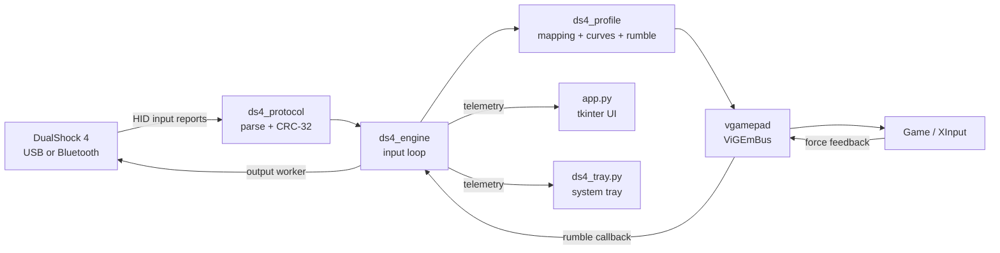

# Architecture

OpenDS4 is a small pipeline: read HID reports from a DualShock 4, turn them into a neutral state object, map that state through a profile, and write the result to a virtual Xbox 360 controller. Feedback flows the other way, from the virtual controller back to the physical pad's lightbar and motors.

## Data flow

## Threads

| Thread | Name | Responsibility |
| --- | --- | --- |
| Main | `MainThread` | `tkinter` event loop, rendering, profile edits. |
| Input | `OpenDS4-Input` | Opens the HID device, reads reports, parses them, maps them, and applies the result to the virtual pad. |
| Output | `OpenDS4-Output` | Sends lightbar and rumble output reports. Runs independently so a slow Bluetooth write cannot stall input polling. |
| Tray | tray worker | Runs the Win32 `GetMessageW` loop for `Shell_NotifyIconW`, repaints the icon, and posts menu actions to the UI through a `SimpleQueue`. |

The input loop uses a read timeout instead of `time.sleep`, and the output worker wakes on an event. This is verified by `tests/test_ds4.py`, which rejects any `time.sleep` call in `ds4_engine.py`.

Timing targets:

- Input and simulator loop: 250 Hz (4 ms per frame).
- Lightbar animation refresh: 40 ms while an animated mode or active motors are present, 250 ms when idle.
- Idle keepalive: one output report every 2 seconds so the pad keeps its LED state.

## Modules

### `ds4_protocol.py`

The only module that knows the wire format.

- Parses USB report `0x01` (64 bytes), minimal Bluetooth report `0x01` (10 bytes), and extended Bluetooth reports `0x11`–`0x19`.
- Verifies Bluetooth input CRC-32 with the Sony seed and signs output reports with seed `0xA2`.
- Decodes the D-pad, face buttons, shoulder buttons, sticks, triggers, battery, gyro, accelerometer, and up to two touch fingers.
- Converts raw stick bytes to signed 16-bit XInput axes: radial deadzone, rescale, response curve, anti-deadzone, sensitivity, and axis inversion.
- Builds USB (`0x05`, 32 bytes) and Bluetooth (`0x11`, 78 bytes) output reports.

### `ds4_profile.py`

A `ControllerProfile` dataclass holds every user setting. `map_to_xbox360` applies the button map, swaps sticks if requested, and produces an `Xbox360OutputState`. `compute_motors` mixes game force feedback, trigger haptics, and the built-in test patterns. `effective_lightbar_bytes` evaluates one of the eight lightbar modes and applies brightness, battery warnings, and rumble flashes.

`ProfileStore` persists profiles as pretty-printed JSON. Writes go to a temporary file and are renamed into place, so a crash cannot leave a half-written profile.

### `ds4_engine.py`

`DS4MapperEngine` owns the two worker threads and the virtual controller.

1. Enumerates HID devices with Sony's vendor ID and a known product ID, preferring the usage page that represents the gamepad interface.
2. Opens the device with `hidapi`.
3. On Bluetooth, reads feature report `0x02` to switch the pad from 10-byte basic reports to 78-byte extended reports.
4. Reads input reports with a timeout, parses them, drops any packet that fails CRC, and maps the result.
5. Applies differential updates to the virtual pad so unchanged buttons are not re-sent.
6. Registers a ViGEmBus rumble callback and forwards game force feedback to the physical pad.

If `vgamepad` is unavailable, the app still reads and displays the controller; it simply cannot create the virtual Xbox 360 device. If `hidapi` is unavailable, it logs a clear message and waits.

### `ds4_touchpad.py`

`TouchpadMouseController` turns raw touch coordinates into mouse actions. It tracks per-finger motion, detects taps by duration and travel, emits wheel events for two-finger vertical slides, and maps physical presses in the left or right zone to held mouse buttons. Actions are dispatched through `SendInput` via `ctypes` on Windows and through an injectable callback in tests.

### `ds4_tray.py`

A dedicated-thread implementation of `Shell_NotifyIconW`. The worker runs its own `GetMessageW` loop and communicates with the UI only through a thread-safe `SimpleQueue`, so Win32 callbacks and `TrackPopupMenu` never re-enter Tcl/Tk. The module uses explicit fixed-width ABI types (`HANDLE`, `WPARAM`, `LPARAM`, and friends) instead of `ctypes.wintypes`, which keeps the structures identical on 32-bit and 64-bit Python. `render_gamepad_icon_rgba` draws the tray icon in memory, and `build_tray_menu_tree` builds a declarative menu description that the tray thread turns into a Win32 `HMENU`. On non-Windows platforms the module degrades to a no-op and remains importable for tests.

### `app.py`

The `tkinter` interface: a top status bar, five pages, and the shared widgets (`ModernSlider`, `ToggleSwitch`, `SegmentedBar`). The window applies a dark DWM titlebar on Windows, so the title bar matches the dark theme instead of flashing white. The UI polls engine telemetry every 16 ms while a controller is connected (100 ms while searching) and every 140 ms while hidden to the tray. Widget updates are cached so unchanged values do not trigger Tcl work.

At import time `_attach_local_venv()` adds the project's `.venv` site-packages when the app is started with the system interpreter, which makes `python app.py` work from a plain command prompt. `--self-test` runs a headless check of the Win32 structures, icon renderer, and controller classes; the launcher uses it as a preflight. Fatal startup errors are written to `opends4_error.log` and shown in a Windows message box.

## Simulator

Simulator mode is available from the header. The engine skips HID entirely and feeds a synthetic `DS4InputState` through the same mapping path at 250 Hz. This is useful for checking lightbar and rumble settings without a controller.

## Safety envelope

The offline guarantee is structural, not contractual. `test_security_zero_network_and_zero_exec` walks the AST of every root-level Python file and fails the build if it finds:

- imports of networking modules
- `subprocess`
- calls to `eval`, `exec`, `compile`, or `__import__`
- non-ASCII text or emoji in source files

Adding a feature that needs the network requires changing that test, which is a deliberate design decision rather than an accident of implementation.
